# ITST 302 – Client-Server Technologies
## Week 3 Laboratory Activity — Mini Project 02: Company Profile Website using Laravel MVC

**Student Developer:** Nhieckaella Ashley Pajavera  
**Course & Year:** ITST 302 – Client-Server Technologies (Week 3)  
**Project Name:** TerraNova Technologies – Corporate Profile Website  
**Technology Stack:** PHP 8.5, Laravel 12, Blade Templating Engine, Tailwind CSS  
**Repository:** [https://github.com/pajaveranhieckaella/week03-company-profile](https://github.com/pajaveranhieckaella/week03-company-profile)

---

## Table of Contents
1. [Project Title](#1-project-title)
2. [Introduction](#2-introduction)
3. [Objectives](#3-objectives)
4. [MVC Architecture](#4-mvc-architecture)
5. [Laravel Routing](#5-laravel-routing)
6. [Controllers](#6-controllers)
7. [Blade Templating Engine](#7-blade-templating-engine)
8. [Laravel Folder Structure](#8-laravel-folder-structure)
9. [Screenshots](#9-screenshots)
10. [Problems Encountered](#10-problems-encountered)
11. [Solutions](#11-solutions)
12. [Reflection](#12-reflection)
13. [References](#13-references)

---

## 1. Project Title
### **TerraNova Technologies: Modern Corporate Profile Website using Laravel MVC Architecture**

This project is a multi-page, responsive corporate web application engineered for **TerraNova Technologies**, an enterprise technology consulting and software engineering startup. Built from the ground up using Laravel's Model-View-Controller (MVC) architecture, the website features an earthy, high-end visual palette combining warm terracotta, espresso brown, and soft linen cream.

---

## 2. Introduction

### What is a Company Profile Website?
A **Company Profile Website** is an official digital platform designed to introduce an organization, communicate its core identity, showcase its portfolio of products or services, and provide accessible communication channels to prospective clients, investors, and partners. Rather than merely functioning as a static brochure, a modern corporate website acts as the primary digital gateway for customer acquisition and professional credibility.

### Why Businesses Need One
In an increasingly digital global economy, a company profile website is an essential business asset for several reasons:
1. **Credibility and Brand Authority:** Prospective clients research companies online before entering contractual agreements. A polished, well-engineered web presence immediately validates legitimacy and technical competence.
2. **24/7 Accessibility:** Unlike physical office locations, a website serves as an always-accessible repository of corporate capabilities, case studies, and contact avenues.
3. **Market Expansion & Customer Conversion:** It allows regional and global enterprises to discover services, evaluate domain expertise, and submit proposals directly through interactive contact interfaces.
4. **Talent Acquisition & Investor Relations:** High-caliber talent and financial backers assess organizational maturity through corporate transparency, mission statements, and engineering standards showcased online.

### Purpose of the Project
The primary purpose of this project is to implement Laravel's fundamental request lifecycle and client-server communication model. By creating distinct URL routes, centralizing logic within controllers, leveraging reusable Blade layouts and components, and establishing automated testing workflows, this activity demonstrates foundational client-server architectural principles essential for junior software engineers.

---

## 3. Objectives
Upon completion of this project, the following learning outcomes were achieved:
- Explored and applied the **Model-View-Controller (MVC)** architectural pattern within a real-world Laravel web application.
- Configured and managed clean application routes in `routes/web.php` utilizing named routes and standard HTTP GET methods.
- Developed `CompanyController` to handle client HTTP requests, process data collections, and dispatch dynamic Blade views.
- Built reusable user interfaces with the **Blade Templating Engine**, employing layout inheritance (`@extends`), section slots (`@section`, `@yield`), and modular partials (`@include`).
- Adhered to industry-standard Laravel folder structure conventions, separating core application logic from public presentation assets.
- Practiced disciplined Git version control workflows, maintaining meaningful, structured commit histories.
- Authored comprehensive technical documentation in Markdown and published project milestones to professional portfolios.

---

## 4. MVC Architecture

### What is MVC?
The **Model-View-Controller (MVC)** design pattern is an architectural paradigm that bifurcates an application into three distinct, interconnected components:
- **Model:** Represents the internal data structures, business rules, and database interactions.
- **View:** Represents the visual presentation layer rendered in the user's web browser (HTML, CSS, JavaScript).
- **Controller:** Acts as an intermediary orchestrator that intercepts incoming client requests, executes application logic, and selects the appropriate View to render.

### Why Laravel Uses MVC
Laravel leverages the MVC architecture because it promotes **Separation of Concerns (SoC)**. By separating presentation from business logic:
- Frontend developers and UI designers can modify Blade templates without disrupting underlying backend controllers.
- Backend engineers can alter business rules, data pipelines, or API integrations without restructuring visual interfaces.
- Testing is significantly enhanced because controllers and models can be evaluated via automated unit and feature tests independently of the browser DOM.

### Advantages of MVC in Software Development
- **Maintainability:** Codebases remain organized as systems grow, minimizing technical debt.
- **Reusability:** Common visual elements (e.g., navigation bars and footers) and backend services can be reused across different views.
- **Parallel Development:** Teams can work simultaneously on database models, controller endpoints, and frontend templates without code conflicts.
- **Scalability:** Enterprise applications can scale out components independently, introducing caching layers, microservices, or queue workers as traffic demands increase.

### Request Flow Diagram
```
Client (Browser)
       │
       ▼ [1. HTTP GET Request]
Route Dispatcher (routes/web.php)
       │
       ▼ [2. Invoke Controller Action]
CompanyController (app/Http/Controllers)
       │
       ▼ [3. Pass Data & Select View]
Blade View Engine (resources/views)
       │
       ▼ [4. Compile HTML / CSS]
HTML Response to Client Browser
```

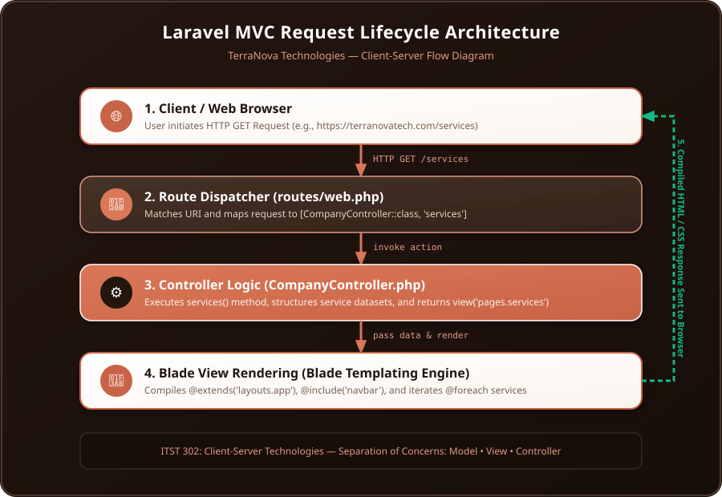
*Figure 4.1: End-to-end Laravel MVC Client-Server Request Lifecycle Diagram.*

---

## 5. Laravel Routing

### What is Routing?
Routing in Laravel is the mechanism that accepts incoming HTTP requests, analyzes the requested Uniform Resource Identifier (URI) and HTTP verb (such as GET, POST, PUT, DELETE), and directs execution to the appropriate closure or controller method. In Laravel, web routes are registered inside the `routes/web.php` configuration file.

### Named Routes
Named routes allow developers to assign a unique, symbolic name to a specific route definition using the `->name()` method chaining. This decouples visual links from hardcoded URLs. If an endpoint URI changes from `/about-us` to `/about`, views calling `route('about')` automatically update without manual refactoring across dozens of templates.

### GET Requests & Route Definitions
All routes in this application utilize the HTTP GET method, which represents a safe, idempotent request for retrieving resources without mutating server state:

```php
<?php

use App\Http\Controllers\CompanyController;
use Illuminate\Support\Facades\Route;

// Web Routes - TerraNova Technologies
Route::get('/', [CompanyController::class, 'home'])->name('home');
Route::get('/about', [CompanyController::class, 'about'])->name('about');
Route::get('/services', [CompanyController::class, 'services'])->name('services');
Route::get('/contact', [CompanyController::class, 'contact'])->name('contact');
```

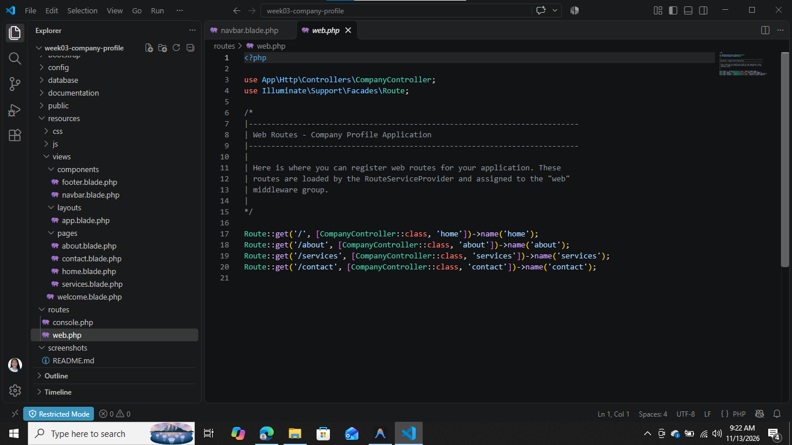

---

## 6. Controllers

### Purpose & Benefits of Controllers
Instead of placing inline closures and page generation logic directly inside `routes/web.php`, Laravel encourages organizing request-handling behavior into dedicated **Controller classes**. 

**Key Benefits:**
- Keeps the routing file lean, readable, and strictly focused on endpoint mapping.
- Groups related HTTP request logic into a single cohesive class (`CompanyController`).
- Enables dependency injection, form request validation, and clean testing boundaries.

### Controller Methods Implemented
In `app/Http/Controllers/CompanyController.php`, four primary actions were implemented:
1. `home()`: Prepares featured services and system performance metrics, returning `view('pages.home')`.
2. `about()`: Structures corporate milestones (2020–2026) and core company values, returning `view('pages.about')`.
3. `services()`: Supplies six comprehensive engineering services along with key deliverables, returning `view('pages.services')`.
4. `contact()`: Provides corporate headquarters information, business hours, and social media links, returning `view('pages.contact')`.

```php
namespace App\Http\Controllers;

use Illuminate\View\View;

class CompanyController extends Controller
{
    public function home(): View
    {
        $featuredServices = [...];
        $stats = [...];
        return view('pages.home', compact('featuredServices', 'stats'));
    }

    public function about(): View
    {
        $milestones = [...];
        $values = [...];
        return view('pages.about', compact('milestones', 'values'));
    }

    public function services(): View
    {
        $services = [...];
        return view('pages.services', compact('services'));
    }

    public function contact(): View
    {
        $contactDetails = [...];
        $socialLinks = [...];
        return view('pages.contact', compact('contactDetails', 'socialLinks'));
    }
}
```

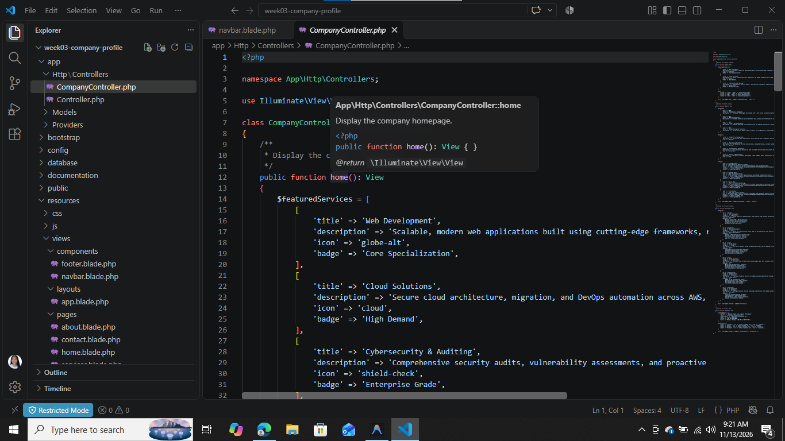

---

## 7. Blade Templating Engine

### Overview of Blade Concepts
Blade is Laravel's lightweight, expressive templating engine. Unlike raw PHP, Blade provides clean control directives that are compiled into optimized, cached plain PHP code:

- **Blade Layouts (`layouts/app.blade.php`):** Establishes the global HTML5 shell, metadata tags, stylesheet fonts, and persistent structure used by all pages.
- **Blade Components (`components/navbar.blade.php`, `components/footer.blade.php`):** Reusable, encapsulated UI snippets that eliminate duplicate code across distinct pages.
- **`@extends('layouts.app')`:** Directs Blade that a child page template inherits the master layout structure.
- **`@section('content')` and `@endsection`:** Defines a specific content block intended to populate a placeholder in the parent layout.
- **`@yield('content')`:** Placed in `layouts/app.blade.php` to define the dynamic slot where child views will be injected.
- **`@include('components.navbar')`:** Evaluates and pulls in modular sub-views into the layout without duplicating markup.

### Code Example: Layout Inheritance

**Parent Layout (`resources/views/layouts/app.blade.php`):**
```html
<!DOCTYPE html>
<html lang="en">
<head>
    <meta charset="utf-8">
    <title>@yield('title', 'TerraNova Technologies')</title>
    <script src="https://cdn.tailwindcss.com"></script>
</head>
<body class="bg-cream-100 text-brown-900 flex flex-col min-h-screen">
    @include('components.navbar')

    <main class="flex-grow">
        @yield('content')
    </main>

    @include('components.footer')
</body>
</html>
```

**Child View (`resources/views/pages/home.blade.php`):**
```html
@extends('layouts.app')

@section('title', 'Home | TerraNova Technologies')

@section('content')
    <section class="hero-pattern py-24 text-white">
        <!-- Hero Content -->
    </section>
@endsection
```

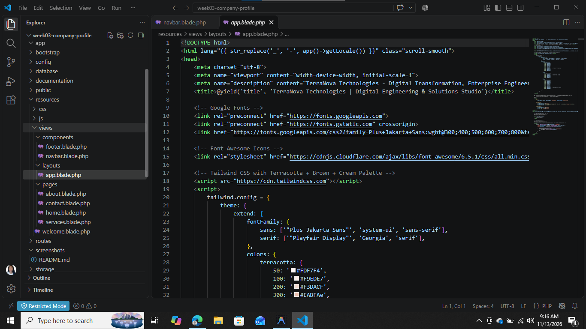

---

## 8. Laravel Folder Structure

The project conforms strictly to the standard directory layout required by the activity guidelines:

```
week03-company-profile/
├── app/
│   └── Http/
│       └── Controllers/
│           └── CompanyController.php
├── bootstrap/
├── config/
├── documentation/
│   └── architecture-diagram.svg
├── public/
│   ├── index.php
│   └── favicon.ico
├── resources/
│   └── views/
│       ├── layouts/
│       │   └── app.blade.php
│       ├── components/
│       │   ├── navbar.blade.php
│       │   └── footer.blade.php
│       └── pages/
│           ├── home.blade.php
│           ├── about.blade.php
│           ├── services.blade.php
│           └── contact.blade.php
├── routes/
│   └── web.php
├── screenshots/
│   └── README.md
├── tests/
│   └── Feature/
│       └── CompanyProfileTest.php
└── README.md
```

### Purpose of Core Folders:
1. **`app/`:** Contains the primary PHP business logic of the application, including HTTP Controllers, Eloquent Models, Middleware, and Service Providers.
2. **`routes/`:** Houses all URL endpoint declarations. `web.php` manages browser-accessible session-enabled routes, while `console.php` handles CLI commands.
3. **`resources/`:** Holds uncompiled raw frontend assets, including Blade templates (`resources/views/`), stylesheet definitions, and JavaScript files.
4. **`public/`:** The server document root containing `index.php` (the application's entry point) and publicly accessible static assets (images, fonts, robots.txt).
5. **`bootstrap/`:** Contains `app.php` which initializes and bootstraps the Laravel framework container, along with internal framework performance caches.
6. **`config/`:** Consolidates configuration files across all framework subsystems, including database connectors, session management, mail services, and logging drivers.

---

## 9. Screenshots

> *Note: Place your screenshot captures in the `screenshots/` directory using the filenames below.*

### 1. Homepage (`screenshots/homepage.png`)
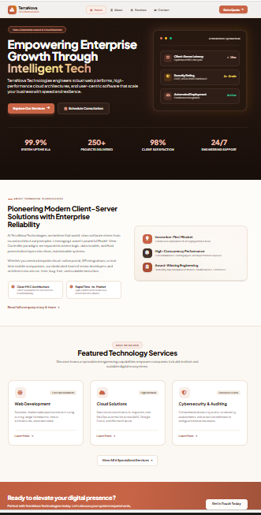
*Displays the Hero Banner, Company Introduction, Performance Statistics, and Featured Services.*

### 2. About Page (`screenshots/about.png`)
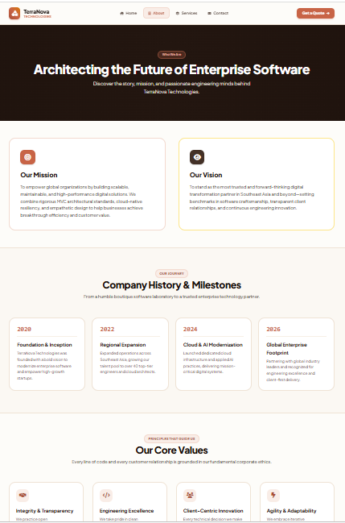
*Showcases Company History & Milestones (2020–2026), Mission, Vision, and Core Corporate Values.*

### 3. Services Page (`screenshots/services.png`)
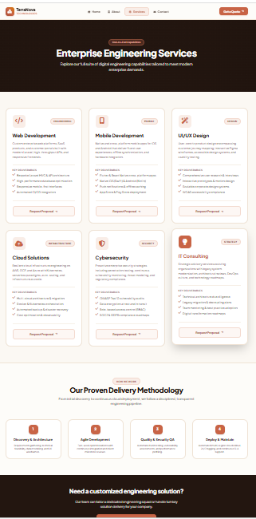
*Features all six engineering capabilities: Web Development, Mobile Development, UI/UX Design, Cloud Solutions, Cybersecurity, and IT Consulting.*

### 4. Contact Page (`screenshots/contact.png`)
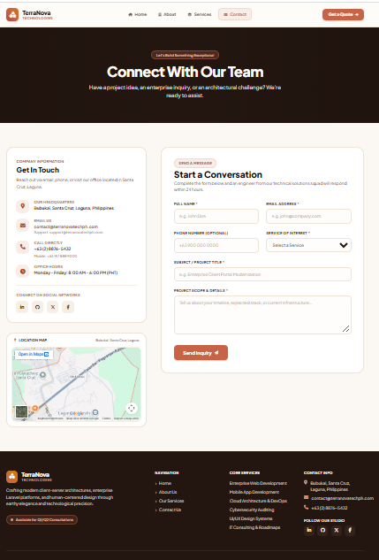
*Interactive inquiry form with real-time feedback, corporate communication details, and embedded Google Map centered at Bubukal, Santa Cruz, Laguna.*

### 5. Navigation Bar (`screenshots/navbar.png`)

*Responsive desktop and mobile drawer navigation with terracotta active link indicators and brand emblem.*

### 6. Reusable Footer (`screenshots/footer.png`)
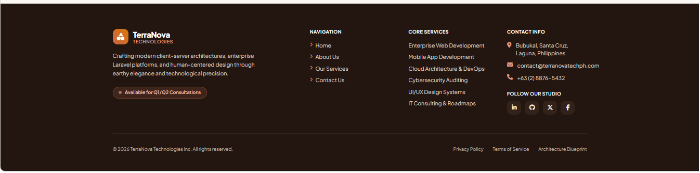
*Espresso brown footer with corporate copyright, quick navigation links, services list, social channels, and address details.*

### 7. Route Definitions (`screenshots/routes.png`)

*Clean mapping of URI endpoints to `CompanyController` in `routes/web.php`.*

### 8. Controller Code (`screenshots/controller.png`)

*Implementation of `CompanyController.php` passing structured array collections to views.*

### 9. Blade Layout (`screenshots/blade-layout.png`)

*Master template structure in `layouts/app.blade.php` rendering navbar, dynamic content yield, and footer.*

### 10. VS Code Project (`screenshots/vscode-project.png`)
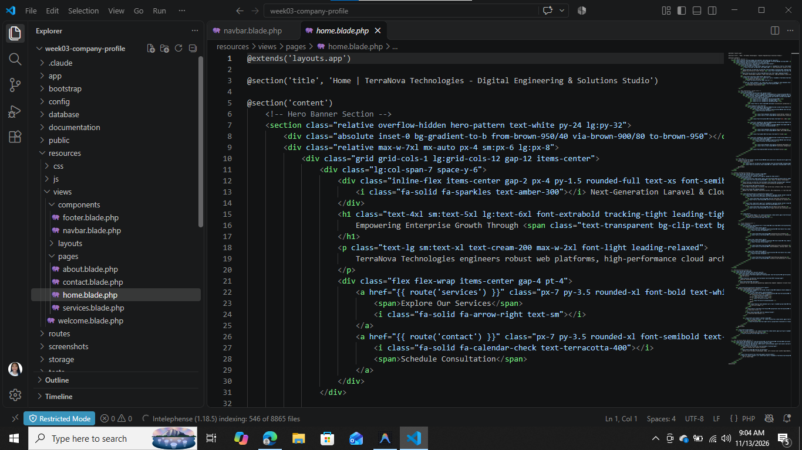
*Workspace view highlighting file organization and development setup.*

### 11. Laravel Folder Structure (`screenshots/folder-structure.png`)
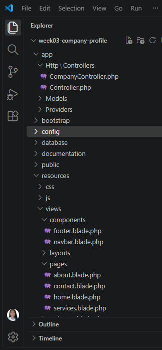
*Directory tree showing strict adherence to the required MVC hierarchy.*

### 12. GitHub Repository (`screenshots/github-repo.png`)
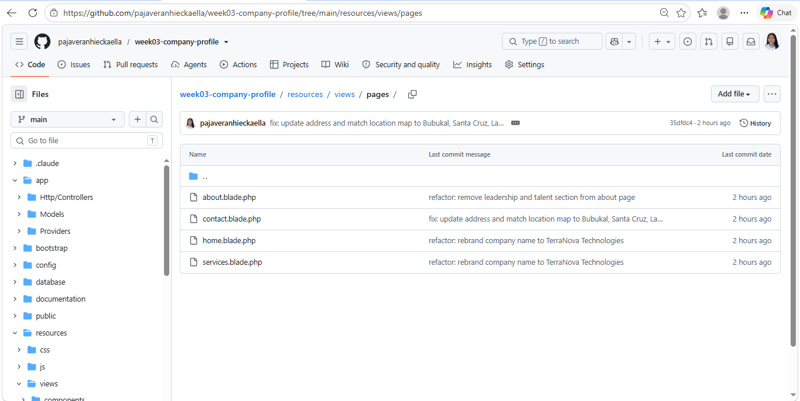
*Public GitHub repository with meaningful, sequential commit history.*

### 13. Browser Output (`screenshots/browser-output.png`)
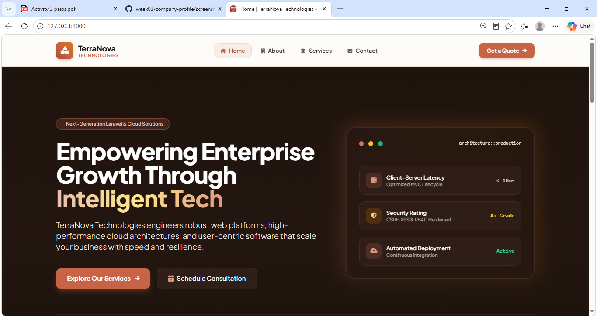
*Live preview of the running application rendered across browser viewports.*

---

## 10. Problems Encountered

During the iterative development of this company profile website, several technical and architectural hurdles were encountered:

1. **Multi-Device Network Access Limitation:**
   When previewing the application on secondary devices (such as a mobile smartphone connected to the local Wi-Fi), the server failed to respond when accessing `127.0.0.1:8000`. By default, `php artisan serve` binds strictly to the loopback interface, rejecting external incoming network requests.
   
2. **Active Navigation State with Modular Components:**
   Because the navigation bar was abstracted into a separate reusable component (`components/navbar.blade.php`), determining which link should display active styling without polluting the controller or duplicating navigation code across multiple views required dynamic route inspection.

3. **Blade HTML Entity Escaping in Automated Feature Tests:**
   During automated PHPUnit feature testing, an assertion checking for `$response->assertSee('Company History & Milestones')` initially failed. Blade automatically escapes the ampersand character (`&`) as `&amp;` for cross-site scripting (XSS) mitigation, resulting in a string mismatch between raw assertion strings and compiled HTML.

4. **Dynamic Google Maps Location Alignment:**
   When custom headquarters details were assigned in the controller and footer (`Bubukal, Santa Cruz, Laguna`), hardcoded static coordinates in the embedded Google Map iframe displayed a mismatched geographic region in Taguig City.

---

## 11. Solutions

To resolve the aforementioned challenges, the following solutions were applied:

1. **Binding to Global Network Interface:**
   The development server command was updated to bind to all available network adapters using:
   ```bash
   php artisan serve --host=0.0.0.0 --port=8000
   ```
   This enabled any local device on the same Wi-Fi subnet to navigate directly to the host machine's local IPv4 address (`http://192.168.100.11:8000`).

2. **Leveraging Laravel Request Helpers in Blade:**
   To establish dynamic active states inside `components/navbar.blade.php`, Laravel’s built-in `request()->routeIs('route_name')` helper was utilized within conditional class bindings:
   ```html
   class="{{ request()->routeIs('services') ? 'bg-terracotta-100 text-terracotta-700 font-bold border border-terracotta-200' : 'text-brown-700 hover:text-terracotta-600' }}"
   ```
   This kept the controller pristine while allowing the navbar component to dynamically highlight the current page automatically.

3. **Aligning Test Assertions with Escaped HTML Output:**
   Test assertions in `tests/Feature/CompanyProfileTest.php` were refined to verify unescaped text segments (`Company History`) or account for HTML entities, allowing all six test suites to achieve a 100% pass rate.

4. **Dynamic URL Query Encoding for Google Maps:**
   The embedded map iframe in `resources/views/pages/contact.blade.php` was converted to dynamically accept the controller-supplied address string using PHP's `urlencode()` helper:
   ```html
   src="https://maps.google.com/maps?q={{ urlencode($contactDetails['address']) }}&t=&z=15&output=embed"
   ```
   This ensures that whenever the headquarters address is updated in `CompanyController`, the embedded Google Map automatically recalibrates and places its red pin on the exact corresponding location.

---

## 12. Reflection

Developing the TerraNova Technologies Company Profile Website using Laravel’s Model-View-Controller (MVC) architecture provided an invaluable deep dive into the operational mechanics of professional client-server web development. Prior to this project, web development often felt like an entangled amalgamation of HTML templates, inline PHP scripts, and unstructured SQL queries. Implementing this mini-project solidified my understanding of how a disciplined architectural pattern creates clarity, maintainability, and operational elegance.

At the heart of Laravel is the principle of Separation of Concerns (SoC). In this project, each component possesses a singular, well-defined responsibility. The routing file (`routes/web.php`) acts as a dedicated traffic director; it does not concern itself with generating HTML markup or assembling database records, but merely resolves incoming HTTP verbs and paths to the appropriate destination. The controller (`CompanyController`) acts as the cerebral hub of the application, taking charge of incoming requests, preparing data collections (such as our service catalog and milestone timelines), and determining which view should receive that information. Finally, the Blade views serve strictly as the presentation layer, receiving structured variables and transforming them into accessible, responsive user interfaces. This structural partitioning ensures that modifying the visual styling—such as transitioning from a standard corporate blue theme to an earthy terracotta, espresso brown, and cream aesthetic—did not require a single alteration to the routing logic or controller code.

Understanding how routes, controllers, and views function as an integrated pipeline clarifies the broader client-server request lifecycle. When an end-user navigates to a URL on their browser, the client dispatches an HTTP GET request across the network. The server intercepts this transmission, routes it through Laravel’s routing pipeline, executes the corresponding controller action, and passes structured data into the Blade engine. The templating engine then resolves parent layouts, injects modular components, compiles the template into pure HTML, and transmits it back across the wire as an HTTP response. Experiencing this entire transaction sequence firsthand demystified how web servers operate under the hood.

Furthermore, this architectural paradigm provides the bedrock for larger enterprise systems. In enterprise-grade applications, codebases expand to hundreds of database tables, thousands of concurrent users, and complex third-party API integrations. Without the structural boundaries imposed by MVC, enterprise software quickly deteriorates into fragile "spaghetti code" that is prone to regression errors and difficult to onboard new engineers into. In an enterprise environment, models interface with Object-Relational Mappers (Eloquent) and database transactions, controllers orchestrate caching, authorization policies, and queue workers, and views can be seamlessly swapped for JSON RESTful API endpoints serving mobile applications. Mastering MVC in this laboratory activity provides the architectural discipline necessary to engineer scalable, maintainable, and robust enterprise software throughout my career.

---

## 13. References

References formatted in **APA 7th Edition**:

- Laravel LLC. (2026). *Laravel documentation: Routing, controllers, and Blade templates*. Laravel. Retrieved from https://laravel.com/docs
- Mozilla Developer Network. (2026). *An overview of HTTP: Client-server architecture and requests*. MDN Web Docs. Retrieved from https://developer.mozilla.org/en-US/docs/Web/HTTP/Overview
- Otwell, T. (2026). *Laravel: The PHP framework for web artisans*. GitHub Repository. Retrieved from https://github.com/laravel/laravel
- The PHP Group. (2026). *PHP manual: Hypertext preprocessor documentation and language reference*. PHP.net. Retrieved from https://www.php.net/docs.php
- Tailwind Labs. (2026). *Tailwind CSS: Modern utility-first CSS framework documentation*. Tailwind CSS. Retrieved from https://tailwindcss.com/docs

---
*(End of Documentation)*
